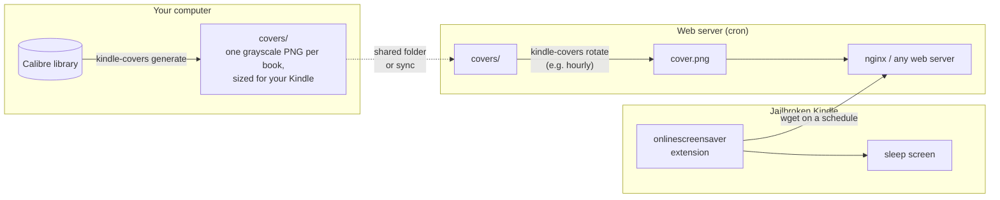
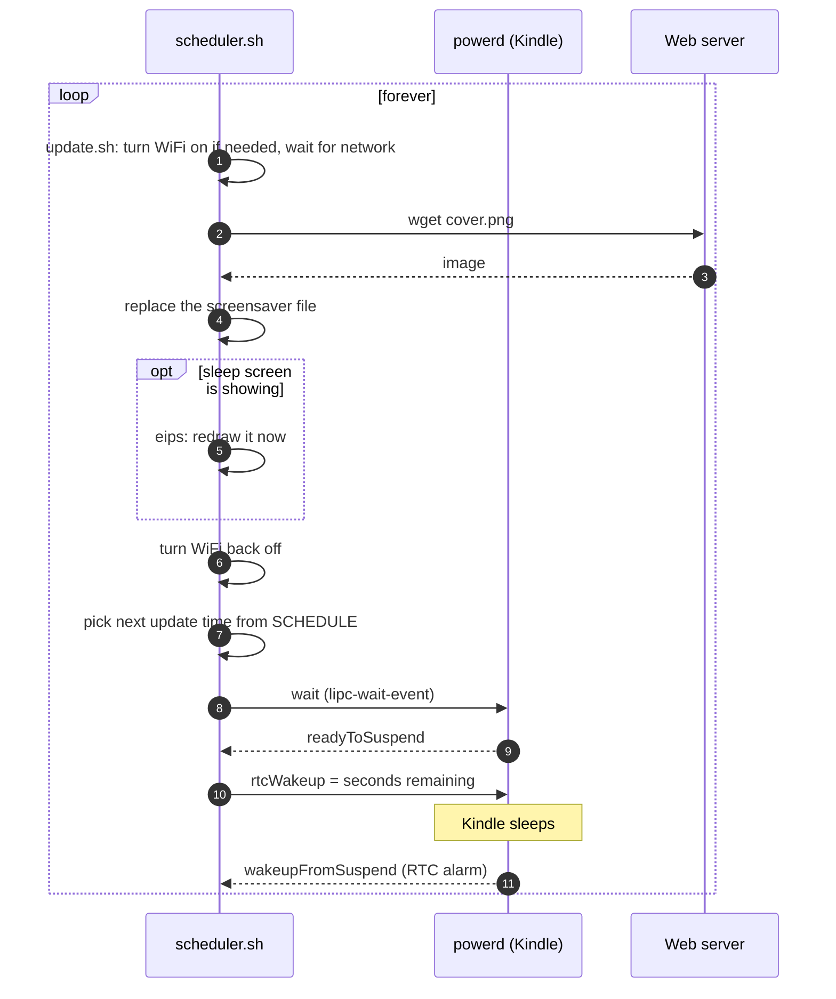

# kindle-cover-screensaver

Turn your Kindle's sleep screen into a rotating gallery of the books you've read.

Every so often the Kindle wakes up, downloads a fresh cover from your own web server, and goes back to sleep. Covers come from your [Calibre](https://calibre-ebook.com/) library, and you can limit them to the books you've marked as read.

## Table of contents

- [How it works](#how-it-works)
- [What you need](#what-you-need)
- [Quickstart](#quickstart)
  - [1. Generate covers](#1-generate-covers)
  - [2. Serve a rotating cover](#2-serve-a-rotating-cover)
  - [3. Set up the Kindle](#3-set-up-the-kindle)
- [Reference](#reference)
- [Troubleshooting](#troubleshooting)
- [Development](#development)
- [Credits & license](#credits--license)

## How it works

There are three parts, and each one runs in a different place:



| Part | Where it runs | What it does |
|---|---|---|
| `kindle-covers generate` | anywhere Calibre's library is reachable | Reads each book's `metadata.opf`, then fits the cover to your screen size, pads it with a border, converts it to grayscale and saves a PNG. Can filter by a custom column, e.g. only books where `Read` is `True`. |
| `kindle-covers rotate` | the web server, from cron | Copies a random cover (never the same one twice in a row) to one fixed path, e.g. `/var/www/kindle/cover.png`. |
| `extension/onlinescreensaver` | the Kindle | A [KUAL](https://www.mobileread.com/forums/showthread.php?t=203326) extension that wakes the Kindle on a schedule, turns WiFi on, downloads the image, puts it on the sleep screen and goes back to sleep. |

The generator and the rotator can run on the same machine. They're separate commands because the library usually lives on a desktop, while the rotation has to happen on something that's always on.

Here's what the Kindle does on each update. This is what keeps the battery cost low:



## What you need

- **A jailbroken Kindle** with:
  - [KUAL](https://www.mobileread.com/forums/showthread.php?t=203326) (Kindle Unified Application Launcher) and kual-helper (same thread)
  - [MobileRead Package Installer](https://www.mobileread.com/forums/showthread.php?t=251143)
  - [FW 5.x ScreenSavers Hack](https://www.mobileread.com/forums/showthread.php?t=195474) (`linkss`)

  For the jailbreak itself, see [WatchThis: software jailbreak for any Kindle ≤ 5.14.2](https://www.mobileread.com/forums/showthread.php?t=346037). For newer firmware, check the MobileRead Kindle forums for current guides.
- **Python 3.10+** wherever you run `kindle-covers`.
- **A Calibre library.**
- **An always-on machine with a web server** that the Kindle can reach, e.g. a NAS, a Raspberry Pi or a home server.

> **Tested on:** Kindle Paperwhite 2. The other device presets use published screen resolutions and haven't been tested. If you get it working on another model, please open an issue or PR.

## Quickstart

### 1. Generate covers

Install the CLI with [pipx](https://pipx.pypa.io/) or [uv](https://docs.astral.sh/uv/):

```sh
pipx install git+https://github.com/davidtorosyan/kindle-cover-screensaver
# or: uv tool install git+https://github.com/davidtorosyan/kindle-cover-screensaver
```

Then point it at your Calibre library:

```sh
kindle-covers generate "$HOME/Calibre Library" ./covers --device kindle_paperwhite2
```

Only want books you've read? In Calibre, add a Yes/No custom column called **Read** (*Preferences → Add your own columns*), tick it for your finished books, and run:

```sh
kindle-covers generate "$HOME/Calibre Library" ./covers -d kindle_paperwhite2 \
    --filter-column Read --filter-value True \
    --border-color black --clean
```

`--clean` deletes covers for books that no longer match, e.g. ones you've removed from the library or unmarked. You can run it repeatedly: existing covers are skipped unless you pass `--force`.

Copy-and-edit scripts are in [`examples/windows`](examples/windows/generate-covers.ps1) and [`examples/linux`](examples/linux/generate-covers.sh). Save your copy as `*.local.ps1` / `*.local.sh` and git won't track it.

### 2. Serve a rotating cover

On the web server, make the `covers/` folder available (a network share, Syncthing, rsync, or run `generate` there directly). Then:

1. Install `kindle-covers` there too (same command as above).
2. Add a cron job to rotate the cover, e.g. hourly ([`examples/linux/crontab`](examples/linux/crontab)):
   ```cron
   0 * * * *  /home/you/.local/bin/kindle-covers rotate /srv/kindle/covers /var/www/kindle/cover.png
   ```
3. Serve the image over **plain HTTP** ([`examples/linux/nginx.conf`](examples/linux/nginx.conf)). The Kindle's built-in `wget` is old and may not handle modern TLS.
4. Check it from another device: `http://your-server.example/kindle/cover.png`

### 3. Set up the Kindle

1. Connect the Kindle over USB.
2. Copy [`extension/onlinescreensaver`](extension/onlinescreensaver) into the `extensions` folder at the root of the Kindle drive (`/mnt/us/extensions/` on the device).
3. In `extensions/onlinescreensaver/bin/`, copy `config_override.sh.example` to `config_override.sh` and set your URL:
   ```sh
   IMAGE_URI="http://your-server.example/kindle/cover.png"
   ```
   Use an editor that keeps **Unix (LF) line endings**. Busybox `sh` on the Kindle won't run files with Windows line endings. This repo's `.gitattributes` keeps the extension files LF.
4. Optionally, adjust `SCHEDULE` and the other settings in [`config.sh`](extension/onlinescreensaver/bin/config.sh).
5. Eject, then on the Kindle open **KUAL → Online-Screensaver**:
   - **Update now** fetches once, so you can test.
   - **Enable auto-download** installs an upstart job that keeps updating, including after reboots.

The extension writes to `/mnt/us/linkss/screensavers/bg_ss00.png` by default. Back up any screensaver already there, and keep only this one file in that folder.

## Reference

### `kindle-covers generate LIBRARY_DIR OUTPUT_DIR`

| Option | Description |
|---|---|
| `-d, --device` | Screen size preset (see below). |
| `-w, --width` / `-h, --height` | Custom size in pixels, instead of `--device`. |
| `-f, --filter-column` / `-v, --filter-value` | Only include books whose custom column matches. The column can be its display name (`Read`) or lookup name (`#read`). |
| `-b, --border-color` | Padding color around covers that don't match the screen's aspect ratio. Default `white`. Any [Pillow color](https://pillow.readthedocs.io/en/stable/reference/ImageColor.html) works. |
| `--force` | Regenerate covers that already exist. |
| `--clean` | Delete PNGs in `OUTPUT_DIR` that don't correspond to a matching book. |

Covers are named `Author - Title.png`.

| `--device` | Resolution | Models |
|---|---|---|
| `kindle_basic` | 600×800 | Kindle (10th gen and earlier) |
| `kindle_paperwhite2` | 758×1024 | Paperwhite 1, 2 ✅ tested |
| `kindle_paperwhite3` | 1072×1448 | Paperwhite 3, 4 |
| `kindle_voyage` | 1072×1448 | Voyage |
| `kindle_basic11` | 1072×1448 | Kindle (11th gen, 2022) |
| `kindle_paperwhite5` | 1236×1648 | Paperwhite 5 (11th gen) |
| `kindle_paperwhite6` | 1264×1680 | Paperwhite (12th gen, 2024) |
| `kindle_oasis` | 1264×1680 | Oasis 2, 3 |

### `kindle-covers rotate COVERS_DIR OUTPUT_PATH`

Copies a random `*.png` from `COVERS_DIR` to `OUTPUT_PATH`, avoiding the cover that's already there. It remembers the current cover in a hidden `.cover.png.source` file next to the output, and writes atomically, so the web server never serves half an image.

### Extension settings ([`config.sh`](extension/onlinescreensaver/bin/config.sh))

| Setting | Default | Meaning |
|---|---|---|
| `IMAGE_URI` | (placeholder) | URL to download. Set this in `config_override.sh`. |
| `SCHEDULE` | `00:00-06:00=480 06:00-22:00=15 22:00-24:00=15` | Space-separated `HH:MM-HH:MM=minutes` ranges; see the comments in the file. Run `bin/checkschedule.sh` over SSH to check it. |
| `DEFAULTINTERVAL` | `300` | Minutes between updates for times not covered by `SCHEDULE`. |
| `SCREENSAVERFILE` | `/mnt/us/linkss/screensavers/bg_ss00.png` | Which screensaver file to overwrite. |
| `DISABLE_WIFI` | `1` | Turn WiFi off after each update. |
| `NETWORK_TIMEOUT` | `30` | Seconds to wait for WiFi after waking. |
| `LOGGING` / `LOGFILE` | `0` / stderr | Set `LOGGING=1` and a file path to debug. |

Anything you set in `config_override.sh` takes precedence. That file is git-ignored, so your URL stays private.

## Troubleshooting

- **The screensaver is blank or white.** The PNG must be grayscale and match the screen resolution exactly. To test, SSH in (USBNet) and run `eips -f -g /mnt/us/linkss/screensavers/bg_ss00.png`. If that fails, check that `--device` matches your Kindle.
- **"Update now" doesn't do anything.** Set `LOGGING=1` and `LOGFILE=/mnt/us/onlinescreensaver.log` in `config_override.sh`, try again, and read the log over USB. A common cause is an HTTPS URL: use plain HTTP.
- **It updates while awake but not while asleep.** Turn on logging and look for `rtcWakeup` and `Received event` lines. If WiFi isn't up in time after a wakeup, raise `NETWORK_TIMEOUT`.
- **The scripts fail with `^M` / `not found` errors.** A file was saved with Windows line endings. Re-copy it from this repo, or convert it with `dos2unix`.
- **To uninstall:** choose **Disable auto-download** in KUAL first, then delete `extensions/onlinescreensaver`.

## Development

```sh
git clone https://github.com/davidtorosyan/kindle-cover-screensaver
cd kindle-cover-screensaver
python -m venv .venv && . .venv/bin/activate   # Windows: .venv\Scripts\activate
pip install -e ".[dev]"
pytest
```

The Python code is formatted with [black](https://github.com/psf/black) and its imports are sorted with [isort](https://github.com/PyCQA/isort) (`profile = "black"`). The tests build a small fake Calibre library, so you don't need Calibre or a Kindle to run them.

```
src/kindle_covers/   Python CLI (generate, rotate)
extension/           Kindle KUAL extension; copy onlinescreensaver/ to the Kindle
examples/            Copy-and-edit runners, cron and nginx examples
tests/               pytest suite
```

## Credits & license

The Kindle extension is a modified version of **[Online Screensaver](https://www.mobileread.com/forums/showthread.php?t=236104)** by *peterson* on MobileRead. It's based on [v0.4](https://www.mobileread.com/forums/showpost.php?p=4330142&postcount=93) with the fixes from [the follow-up post](https://www.mobileread.com/forums/showpost.php?p=4335329&postcount=95). Thanks also to the MobileRead Kindle developer community for KUAL, the screensaver hack and the jailbreak tooling.

Everything else is [MIT](LICENSE). See [LICENSE](LICENSE) for the third-party notice about the extension.
